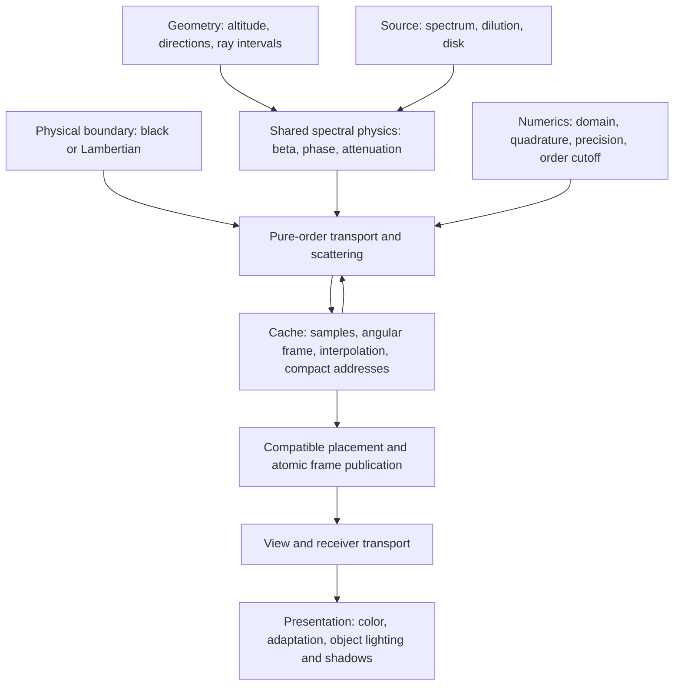

# Local-Sun Abstraction Inventory And Mathematical Defense

P3-A0 analysis completed on 2026-10-09. This document owns the mathematical
inventory; the [design](design.md#assumptions-and-abstraction-boundaries) owns
selected assumptions and the [reference policy](reference-method.md#current-evidence-policy)
owns acceptance. This is source analysis and algebraic derivation, not a new
numerical qualification, experiment run or implementation review.

Current owner clarification: interpolation and integration require a defensible
mathematical rationale, explicit assumptions and ordinary correctness checks.
Targeted experiments to estimate numerical error bounds are deferred future
work, not current completion or pre-recording gates. The
[current defense policy](reference-method.md#current-depth-of-numerical-defense)
owns this distinction. The analysis below identifies limitations without making
their quantitative measurement a prerequisite for proceeding.

The defensible proposal preserves spectral extinction, phase-weighted scattering,
attenuation and pure-order recurrence, substituting flat geometry and a finite
source. Euclidean radius/altitude is a representation of that model. It does not
require a new scattering law or an independent Sun-angle axis under the selected
symmetries. Existing numerical accuracy percentages do not automatically transfer.

Two actual recipe limits are decisive: the current shell prototype uses a black
physical ground (`groundBoundary: null`), and its medium has no ozone absorption.
Neither reflective terrain in an image nor a plausible sky supplies those missing
physical terms. The new interpolation, angular quadrature and path integration
need their own mathematical defense; quantified error estimates are deferred.

## Scope And Reproducible Reading Basis

The owner selected this analysis step after stopping implementation. No solver,
browser capture, compilation, ozone change, production edit or video was run.
The source was inspected at repository HEAD
`d417a9c349528ceb0e66efad95f71c409ba9257d` with existing working-tree changes;
HEAD alone is therefore not an exact source identity. The
[source manifest](abstraction-inventory-sources.json) records content hashes of
the referenced implementations, evidence and control inputs, plus this report's
derivation and identity. It is a reading snapshot, not a validated implementation
closure or a replacement for immutable run provenance.

The [frozen development selection](../../../../../tmp/experiments/local-sun-cache-reuse/runs/00281-p3-selection/selection.json)
has identity `sha256:f5a3330e484602a6deaae09eb3c7aed520692955ff918987cdb829c82e1baeee`:
v9 layout, 1,049 nodes, Native15, four orders, R32F, W27 outgoing directions,
partitioned polar40/azimuth48 incoming directions, `column48-tail64` construction,
`analytic-columns-positive-column15-v1` runtime and 2,048 source-strength bands.
Its disposition remains **unqualified development selection**. The incoming
grid has 1,920 directions; W27 has 4,374. Those dimensions are not shell counts.

The [frozen controls](../../../../../tmp/experiments/local-sun-cache-reuse/runs/00018-controls/controls.json)
use source height 4,828,032 m, calibration distance 4,800,000 m, source radius
25,749.504 m and a 100,000 m atmosphere. The declared construction cylinder has
radius 33,378,000 m, as recorded by [status](status.md#p1-deliverables-and-completion-authority).
Canonical spherical boundaries instead span 6,360,000–6,420,000 m: 60 km thickness.
Matching coefficient formulas does not match these domains. Flat 0/45/90/135/180
are the frozen orbit/clock states, not solar zenith angles. The final film uses
the separately selected December solstice.

## Quantities And Dependency Map

Let x be a point in metres, z its altitude, S=(sx,sy,h) the source center,
rho the horizontal distance to its vertical axis and r=|S-x|. H is atmospheric
top; HR/HM are density scale heights. Omega denotes solid angle; omega denotes
a unit query direction. The implementation's query ray points from the sample
toward the viewed light; its source direction points toward S. Their dot product
is the phase argument. Retain this convention consistently when reversing
physical propagation directions.

Spectral quantities below are densities per nm: irradiance E in
W m^-2 nm^-1, radiance L in W m^-2 sr^-1 nm^-1, scattering density J in
W m^-3 sr^-1 nm^-1. Extinction/scattering coefficients beta are m^-1, phase
p is sr^-1, and optical depth tau, transmission T and albedo are dimensionless.
Native15 packets use their identified contiguous-bin-average wavelength basis;
integration requires its bin measures. Direct40 is a different basis, not fifteen
matching channel indices. Typed packet ownership is in
[spectral-values](../../../../../src/algorithm32/spectral-values/index.js) and
[Native15 constants](../../../../../src/algorithm32/profiles/native-15/consts.js).



The cache-to-order arrow matters: reconstruction error can feed the next order.
Presentation does not feed recurrence. A shadow map is not atmospheric extinction.

## Inventory And Classification

**Exact substitution** means algebraically exact within the declared idealized
model, not empirically established flat-world physics. **Inherited approximation**
means an existing modeling/discretization assumption with its original evidence
limits. **New approximation** requires an explicit mathematical rationale and
stated applicability/limitations; its quantified error is deferred. **Unsupported claim**
is deliberately withheld. Each row's detailed defense and open check follows below.

| Abstraction / design IDs        | Preserved responsibility and original mathematics                                        | Flat/local consequence and classification                                                                                                               | Defense and limit                                                                                                  |
| ------------------------------- | ---------------------------------------------------------------------------------------- | ------------------------------------------------------------------------------------------------------------------------------------------------------- | ------------------------------------------------------------------------------------------------------------------ |
| Medium / A3                     | Exponential densities; spectral Rayleigh/Mie coefficients; scattering versus extinction. | Evaluate at plane altitude rather than radial altitude: exact substitution. Reusing a physical profile is an inherited modeling assumption.             | Same law, different density arguments; no empirical flat-medium profile claim.                                     |
| Spectral accounting / A3,A5     | Identified wavelength basis, physical units, bin measures and scalar channels.           | Native15 remains Native15: inherited spectral approximation.                                                                                            | Basis identity and dimensional consistency; no Direct40 index comparison.                                          |
| Geometry and boundaries / A1,A6 | Geometry supplies valid coordinates and path intervals.                                  | Sphere intersections become planes; construction cylinder and view dome remain distinct finite policies. Exact intersections plus numerical truncation. | Plane/slab algebra below; finite horizontal edge is not a physical atmosphere boundary.                            |
| Source illumination / A2        | Reference spectrum, direction and source-path transmission enter J1.                     | Position-dependent direction and inverse-square dilution: exact point-source substitution outside the radius clamp.                                     | Calibrated hypothetical source; held amplitudes and disk approximation are separate.                               |
| Source disk / A2                | Spectral surface radiance and angular visibility.                                        | Finite apparent radius varies with distance; center-ray illumination remains an inherited approximation.                                                | Display geometry does not establish extended-emitter transport; calibration convention remains open.               |
| Phase / A3                      | Rayleigh and Cornette–Shanks functions of direction dot product.                         | Local source direction varies at each point: exact substitution.                                                                                        | No retuned phase law; quadrature accuracy must be checked for changed angular structure.                           |
| Attenuation / A3,A6             | tau=integral beta_ext ds; T=exp(-tau).                                                   | Flat exponential column admits an analytic integral. Exact real-arithmetic substitution with new floating-point evaluation.                             | Valid for the pinned horizontally uniform exponential medium, not an arbitrary absorbing profile.                  |
| Orders / A5                     | Transport each pure Jk; scatter Lk into Jk+1; sum orders only for consumption.           | Same recurrence, different source/path/field inputs. Four-order truncation is inherited approximation.                                                  | Preserve pure versus cumulative accounting; N4 is not all orders.                                                  |
| Physical ground / A4            | Lambertian alpha/pi and cosine-weighted incident irradiance with return attenuation.     | Plane normal replaces radial normal. Current null boundary selects black ground.                                                                        | Reflective law can transfer conditionally; current black recipe proves no reflective-ground accuracy.              |
| Numerics / A6                   | Weighted integration approximates the same transport operator.                           | New polar/azimuth quadrature, optical-column paths and positive weights. New approximations.                                                            | Positivity/normalization are useful invariants, not convergence evidence.                                          |
| Spatial/angular cache / A7      | Reconstruct J(x,omega,lambda,k) in a local directional frame.                            | Euclidean r/z mesh and angular-frame transformation: exact coordinate substitution; interpolation remains new approximation.                            | Axis/boundary support and direction rotation are essential; angular dependence is retained.                        |
| Normalized reconstruction / A7  | Physical J is stored and restored after interpolation.                                   | Interpolate J/F with F=beta_ext(z)*(h/r)^2: new approximation.                                                                                          | Good smoothness hypothesis; higher diffuse orders need not follow direct inverse-square dilution.                  |
| Empty-band omission / A6,A7     | Remove only mathematically empty scattering domains, preserving support.                 | Outer radius below h-H cannot intersect the slab: exact admission criterion in stated domain.                                                           | Skip allocation and evaluation; tangencies and support are retained. No skipped nonzero propagation.               |
| Movement/publication / A8       | Compatible field identity and exact current-frame consumers.                             | Horizontal rigid transforms exploit symmetry; height/profile changes rebuild. Exact model symmetry plus engineering correctness.                        | Finite domain and all collaborators must transform coherently; shared CPU/GPU code is consistency evidence.        |
| Receiver/presentation / A9      | Integrate sky irradiance; obtain direct light from source/path; map spectra to display.  | Receiver sees current local directions; scene shadows approximate a shared Sun direction. Inherited/new consumer approximations.                        | Coherent lighting is separate from cache accuracy; film interpolation and shadow adapter are presentation choices. |

## Preserved Physics And Derived Geometry Consequences

### Medium, Phase And Attenuation

[CanonicalAtmosphere](../../../../../src/algorithm32/implementation/canonical-atmosphere/CanonicalAtmosphere.js)
implements, wavelength by wavelength:

```text
beta_R(z) = beta_R0 * exp(-z/HR)
beta_Mext(z) = beta_Mext0 * exp(-z/HM)
beta_Msca(z) = wM * beta_Mext(z)
beta_ext = beta_R + beta_Mext + beta_abs
beta_sca = beta_R + beta_Msca
pR(c) = 3/(16*pi) * (1+c^2)
pM(c) = 3/(8*pi) * (1-g^2)/(2+g^2)
        * (1+c^2)/(1+g^2-2*g*c)^(3/2)
```

The [canonical constants](../../../../../src/algorithm32/implementation/canonical-atmosphere/consts.js)
pin HR=8,000 m, HM=1,200 m, wM=0.8 and g=0.7. Rayleigh follows the selected
wavelength^-4 coefficient and Mie the selected Angstrom law. These are borrowed
constitutive choices. Their mathematics is geometry-independent; their empirical
applicability to the hypothetical atmosphere is an explicit assumption. Changing
Mie **single-scattering albedo** changes scattering, not extinction or ground
reflectance. The prototype's runtime albedo control is that Mie parameter.

[Spherical geometry](../../../../../src/algorithm32/implementation/spherical-earth/SphericalEarthGeometry.js)
uses z=|x|-Rbottom; [flat geometry](../../../../../src/algorithm32/implementation/flat-earth/FlatEarthGeometry.js)
uses z=x.z. A flat ray has z(t)=z0+omega_z*t, with plane intersection
t=(zb-z0)/omega_z when positive and otherwise applicable. A horizontal ray has
no top/ground exit; a finite computational edge must be stated explicitly.
The observer's visual dome is a rendering path policy; the source-centered
construction cylinder is a different policy. Neither is implied by flat density.

For a complete admitted straight segment of length ell, flat exponential density
has the analytic column:

```text
q = (z1-z0)/Hs
C = ell * exp(-z0/Hs) * (1-exp(-q))/q
C(q=0) = ell * exp(-z0/Hs)
tau_lambda = beta_R0_lambda*C_R + beta_Mext0_lambda*C_M
T_lambda = exp(-tau_lambda)
```

C has units metres. JS `expm1` and GLSL small-q series evaluate the removable
singularity in [runtime math](../../../../../experiments/local-sun-cache-reuse/shell-runtime-math.js),
[build transport](../../../../../experiments/local-sun-cache-reuse/shell-transport.js)
and [runtime atmosphere](../../../../../experiments/local-sun-cache-reuse/shell-runtime.js).
The integral is exact for the chosen flat exponentials in real arithmetic; finite
precision, GLSL series truncation and finite segments still need bounded checks.
The runtime adapter currently additionally admits only the 0–100 km slab.

For h>H, source direction satisfies mu=(h-z)/r>0. Its path to atmosphere top has
length ell_source=(H-z)/mu; therefore the vertical exponential column is multiplied
by 1/mu. Long oblique paths can remain strongly attenuated. Flat geometry removes
the opaque spherical planet's terminator/shadow mechanism, not attenuation or
all possible brightness gradients. No spherical twilight error bound transfers.

### Source, Disk And Primary Scattering

[LocalSunLightSource.sampleDirectLighting](../../../../../src/algorithm32/implementation/local-sun/LocalSunLightSource.js)
supplies shat=(S-x)/r and E_lambda=a*Eref_lambda*(dref/max(radius,r))^2 when falloff
is enabled. Outside the radius clamp, inverse-square behavior is the selected
isotropic point-source model. The calibration fixes a hypothetical luminosity;
it is not observational evidence for a local Sun. Changing h changes r, mu,
source columns and angular extent together, so rotation alone cannot handle it.

[Primary evaluation](../../../../../src/algorithm32/implementation/distant-sun/cache/DistantSunCpuPrimaryEvaluator.js)
then preserves:

```text
J1_lambda(x,omega) = E_lambda(x) * T_source_lambda(x)
  * [beta_R_lambda(z)*pR(omega dot shat)
     + beta_Msca_lambda(z)*pM(omega dot shat)]
```

Units give W m^-3 sr^-1 nm^-1. Distant illumination instead uses an essentially
uniform incident direction/spectrum; a flat/local substitution changes every
point's amplitude, phase angle and source path. It does not add a phase law.

The [source cache](../../../../../src/algorithm32/implementation/local-sun/cache/LocalSunShellFactCache.js)
and [construction source](../../../../../src/algorithm32/implementation/local-sun/cache/LocalSunConstructionLightSource.js)
hold amplitudes within 2,048 bands equally spaced in inverse squared distance,
using the mean of endpoint scales. Those are an inherited source approximation,
not 2,048 fully sampled scattering surfaces. [Shell source installation](../../../../../experiments/local-sun-cache-reuse/shell-source.js)
replaces the former offset-dependent domain with the fixed source-centered one.
The prototype also uses continuous primary illumination inside direct-L1
transport while stored J1 retains the held-band path. Those distinct operators
must stay identified; they are not automatically the same discretization.

Disk angular radius is alpha=asin(radius/r). Both
[local](../../../../../src/algorithm32/implementation/local-sun/LocalSunLightSource.js)
and [distant source definitions](../../../../../src/algorithm32/implementation/distant-sun/DistantSunLightSource.js)
derive uniform radiance using L=E/Omega, with Omega=2*pi*(1-cos(alpha)).
If E means irradiance on a plane normal to disk center, the exact uniform-disk
relation is E=L*pi*sin(alpha)^2; the ratio of that projected measure to Omega is
(1+cos(alpha))/2. Thus the current shared calibration needs its convention or
small-angle approximation documented. This derivation identifies a focused
calibration question, not a confirmed production defect. A visible finite disk
also does not prove that atmospheric J1 integrates all disk directions.

### Orders And Physical Boundary

The [multiple-scattering evaluator](../../../../../src/algorithm32/implementation/distant-sun/cache/DistantSunCpuMultipleScatteringEvaluator.js)
transports a pure order and scatters its incident radiance into the next:

```text
Lk(x,omega) = integral_0^ell T(x,x+t*omega)*Jk(x+t*omega,omega) dt
             + attenuated compatible boundary radiance, where selected
J(k+1)(x,omega) = integral_S2 Lk(x,omega')
  * [beta_R*pR(omega dot omega')+beta_Msca*pM(omega dot omega')] dOmega'
J_through_N = sum_(k=1..N) Jk
```

Boundary order accounting follows the evaluator: direct reflected illumination
enters the next scattering order, later reflection uses the relevant previous
order. Do not feed cumulative fields as if they were pure previous orders or
add reflected illumination twice. Scalar, stationary, independent-wavelength
transport and finite N are inherited assumptions; this is not polarized,
time-dependent or all-orders transport.

[UniformLambertianGroundBoundary](../../../../../src/algorithm32/implementation/uniform-lambertian-ground/UniformLambertianGroundBoundary.js)
uses BRDF alpha_lambda/pi. Incident ground irradiance is direct E times positive
incidence cosine plus the upper-hemisphere integral of L*cos(theta); outgoing
ground radiance is alpha/pi times that irradiance, followed by return attenuation.
Replacing a radial normal with vertical is exact under homogeneous plane-ground
assumptions. A reflective boundary remains part of the reusable mathematics.

But [rotation-model](../../../../../experiments/local-sun-cache-reuse/rotation-model.js)
actually supplies `groundBoundary: null`. Its current physical ground is black.
The [production ground contract](../../../production-algorithm32/qualification/ground-contract.md)
also retains reflective-ground qualification gaps. We can defend black ground
as an explicit chosen boundary and document the reflective extension; we cannot
claim the current prototype demonstrates that extension. Visual material albedo,
terrain, local bounce and object shadows do not substitute for this boundary.

## Shell Coordinates, Symmetry And New Approximation

### Why A Cross-Section Suffices

For fixed h>H and horizontally uniform medium/ground with isotropic source:

```text
r^2 = rho^2 + (h-z)^2
rho = sqrt(r^2-(h-z)^2)
mu_source = (h-z)/r
```

A sphere of fixed r is a two-dimensional surface. Its vertical cross-section
within the slab, revolved about the source's vertical axis, describes all
equivalent positions on that surface. Axial symmetry reduces positional state
to r,z; the outgoing direction in the appropriate local frame remains necessary.
Its polar/azimuth relation to the source and vertical cannot be discarded.
Altitude plus Euclidean radius already determines the source zenith cosine;
there is no additional independent source-angle coordinate in this model.

This reduction fails with horizontal density variation, nonuniform ground,
anisotropic emission or atmospheric transport coupled to scene occluders. At the
axis, the horizontal frame is degenerate: direction handling must preserve
rotational equivalence rather than invent an arbitrary discontinuity. The
[layout](../../../../../experiments/local-sun-cache-reuse/shell-layout.js) and
[geometry adapter](../../../../../experiments/local-sun-cache-reuse/shell-geometry.js)
provide explicit axis and curved-boundary support. Stable radius excess
e=r-|h-z|=rho^2/(r+|h-z|) avoids subtracting nearly equal large radii; it changes
the numerical coordinate evaluation, not the represented distance.

### Admission And Omission

The minimum distance from S to the infinite admitted slab is h-H. A radial band
whose outer radius is strictly less than h-H has no atmospheric intersection.
It can receive neither scattering slots nor medium evaluation. Tangent bands,
boundary support and any required ray passage remain admitted. Finite cylinder
intersection further bounds support; the simple inner test is conservative,
not a complete universal geometry classifier.

[Omission control](../../../../../experiments/local-sun-cache-reuse/shell-omission.js)
adds explicit empty slots to an otherwise identical occupied-node control.
Recorded compact/unculled equivalence and 103,926,240 bytes saved in logical peak
fields support that measured comparison, as retained in [execution](p3-execution.md).
They do not establish all historical grid savings, GPU telemetry, build speed or
host-memory benefit. The number of omitted narrow inner bands affects actual
savings through the allocations avoided, not through their geometric volume.

### Interpolation Changes The Evaluated Operator

The shell stencil interpolates admitted altitude rows with radius-aware support.
Positive normalized geometric weights and complete support are valuable, but
not field-accuracy proofs. Angular reconstruction remains W27 in a transformed
local frame. The new [spectral normalization](../../../../../experiments/local-sun-cache-reuse/shell-reconstruction.js)
implements:

```text
F_lambda(x) = beta_ext_lambda(z)*(h/r)^2
Jhat_lambda(x) = F_lambda(x) * sum_i w_i(x)*J_lambda(x_i)/F_lambda(x_i)
```

Stored samples remain physical J. The restored formula agrees at nodes and
preserves a constant normalized field J/F, not generally a constant physical J.
F's geometric factor can be useful for direct-light gradients, but diffuse
multiple scattering need not follow inverse-square illumination. Applying it to
higher orders is a **new reconstruction hypothesis**, not a conserved physical
law or demonstrated energy-preserving operator. Its effect propagates through
recurrence. Hard-coded canonical coefficients also limit compatibility with any
future altered extinction profile. No ozone toggle can silently reuse it.

The [angular rule](../../../../../experiments/local-sun-cache-reuse/shell-angular.js)
uses a horizon-partitioned 40-polar by 48-azimuth grid instead of the original
incoming rule. Positive weights summing to 4*pi verify measure, not convergence.
[Build transport](../../../../../experiments/local-sun-cache-reuse/shell-transport.js)
and [runtime](../../../../../experiments/local-sun-cache-reuse/shell-runtime.js)
also replace distance integration with column-based nodes and positive attenuation
weights. For an interval of optical thickness tau, those weights exactly integrate
a source function J/beta_ext **linear in optical depth**, in real arithmetic.
The actual source need not be linear there. The build's tail64 cutoff, quadrature
resolution, endpoint policies, R32F and small-argument series remain explicit
approximations. Exponentially small transmission alone does not bound omitted
radiance without a source bound. These changes need a defensible rationale and
ordinary implementation checks. Their quantitative error bounds are deferred;
they cannot inherit the old grid's numerical error simply by retaining Beer–Lambert.

## Movement, Receivers And Presentation

A horizontal translation/vertical-axis rotation G transforms S and x together,
preserving z, r, rho, path measures and phase dot products. The continuous model
then satisfies J(Gx,Gomega)=J(x,omega). A canonical source-centered domain must
transform too; a fixed world-centered edge or offset-dependent source bands
break this construction symmetry. Changing height, medium, power/spectrum,
radius or physical ground invalidates the relevant field identity. Finite-domain
queries remain admitted explicitly instead of silently clamped.

[Frame publication](../../../../../experiments/local-sun-cache-reuse/shell-frame-publication.js)
separates complete active frames from staging, checks cache/frame identity, holds
leases and rejects stale/cancelled publication. Those mechanisms defend coherent
ownership, not physics or measured device-memory admission. Complete identity
must cover the source, medium, boundary, domain, nodes, integration/reconstruction,
orders, units, precision and implementation. A successful shared CPU/GPU lookup
tests agreement; it is not an independent accuracy reference.

[Receiver integration](../../../../../experiments/local-sun-cache-reuse/shell-receiver.js)
uses the current view transport and direct source state.
[ReceiverEnvironmentLightQuadrature](../../../../../src/algorithm32/implementation/scene-lighting/ReceiverEnvironmentLightQuadrature.js)
approximates E_sky=integral_upper L*cos(theta)dOmega using 32 cosine-weighted
Hammersley directions, each weighted pi/32. Constant radiance yields pi*L;
strong local anisotropy remains a limitation; quantitative receiver sensitivity
can be investigated later. Surface-light
units, adaptation and spectral color conversion must remain separate from J.

The ordinary experimental scene keeps six per-object shadows. A directional
shadow approximation holds the source direction across a small scene; the local
direction actually varies by roughly scene extent/source distance. A shared
shadow field and film-time interpolation in the final recording are separate
presentation choices retained by [P6](plan.md#p6--reproduce-the-local-sun-full-orbit-film).
Neither proves the atmospheric cache's physical accuracy or changes its boundary.

## What The Existing Evidence Defends

- [Distant acceptance](../../../production-algorithm32/caches/distant-sun-strobing-acceptance.md)
  and [promotion status](../../../production-algorithm32/caches/distant-sun-strobing-promotion-status.md)
  support identified distant Native48/cubic cache, physical comparisons and
  selected runtime behavior in their tested profiles. Their Native15/Direct40
  profiles disable ozone, and incoming-quadrature uncertainty remains explicit.
  The 109-scene qualification is not a proof of each component or a local-Sun bound.
- [Transfer assessment](../../../production-algorithm32/caches/local-sun-transfer-assessment.md)
  supports the symmetry derivation and initial CPU source-policy probes. It did
  not build a complete GPU cache. Agreement with the old local cache measures
  behavioral change, not closeness to physical truth.
- [P3 execution](p3-execution.md) preserves omission, movement, runtime/lifecycle
  and selected reconstruction observations with their original flags. Higher-order
  reference convergence remains inconclusive. The new evidence policy neither
  passes those cells nor widens their limits. This analysis does not revalidate
  old review ledgers or rehash large historical field payloads.

The inherited laws are therefore supportable methods with explicit assumptions;
the new discretized flat/local realization is still partly qualified. No measured
universal accuracy percentage or empirical flat-world validation is claimed.

## Informative Compensating Errors And Ozone

This section is informative only. Sky Accuracy Dials remains suspended. No
correction adoption, acceptance oracle or cancellation campaign is selected.

Its [findings brief](../sky-accuracy-dials/accuracy-findings-brief.md) and
[targeted results](../sky-accuracy-dials/targeted-improvements-results.md) show
that density reconstruction and source-column attenuation errors can oppose one
another. The joint density/phase/column correction reduces reported P1 RMS from
9.010 to 0.048 mW (99.47%), while the frozen higher-order proxy worsens by 3.90%.
Those are specific distant-study measurements, not local predictions. Algebraically,
for error vectors n and r, squared error is |n+r|^2=|n|^2+2*n dot r+|r|^2;
a negative cross term can conceal large component errors.

Flat/local paths change density arguments, source angles, dilution and angular
weighting. New reconstruction can change the magnitude and sign of errors fed
into recurrence. Black versus reflective ground and omitted orders can further
change the balance. Thus component improvement need not monotonically improve
the final comparison; the same cancellation or its signs cannot be presumed
to transfer. These are implications of the operator, not measured local effects.

The inspected [Dials profile](../../../../../experiments/sky-accuracy-dials/numerics/profile.js)
requires ozone disabled in its baseline. Canonical constants also disable it,
`CanonicalAtmosphere.sampleMedium` returns zero absorption, and the shell's
analytic columns contain only Rayleigh and Mie extinction. The
[follow-up context](../sky-accuracy-dials/follow-up-context.md) treats missing
gaseous absorption as an untested lead. An ozone-specific quantified cancellation
result was **not located in the inspected reports**; that is an evidence gap,
not a project-wide claim that none exists.

If ozone were separately selected, its mathematical contribution would be
beta_O3(lambda,z)=sigma_O3(lambda)*n_O3(z), with consistent cross-section and number-
density units, entering source, view, inter-order and ground-return optical depths.
Pure absorption adds no scattering source or phase term. The absorption spectrum,
vertical profile, wavelength-bin integration, analytic-column replacement and
cache identity would all need explicit ownership. None is selected/enabled here;
setting a flag alone would not implement those missing terms. With other inputs
fixed, additional absorption cannot explain a needed increase in brightness.
This does not exclude coupled effects or justify fitting ozone to cancel another
error. Ozone support cannot be inferred from a pleasant RGB result.

## Transfer Gaps And Bounded Verification Recommendations

These are possible checks, **not tasks run by this analysis or a mandatory
accuracy-research sequence**. Current work needs mathematical defensibility and
ordinary correctness/engineering checks. Quantitative resolution, quadrature,
path and order sensitivity studies are deferred to later owner-selected work;
they do not block completion or the recording. P3-A versions that distinction
in its claim/gate contract. Keep compatible correctness tolerances and old
dispositions; maintain the untouched Flat90 holdout. Use JavaScript proof scripts
where useful, not a new global solver or executable.

| Priority / claim                                | Smallest useful check                                                                                                                                                                                       | What it can establish; remaining limit                                                                                                          |
| ----------------------------------------------- | ----------------------------------------------------------------------------------------------------------------------------------------------------------------------------------------------------------- | ----------------------------------------------------------------------------------------------------------------------------------------------- |
| 1. Geometry, optical columns and units          | Analytic vertical/horizontal/oblique plane paths; reciprocity/additivity of tau; zero-length and near-horizontal limits; source E*r^2 invariant outside clamp; Native15 basis/unit validation.              | Substitution and implementation consistency within pinned slab/medium. Does not prove profiles describe a real atmosphere.                      |
| 2. Shared-method transfer                       | Near/far source comparison holding incident E fixed; local spherical/flat patch comparison with stated curvature bound and matched atmosphere height, coefficients and boundary.                            | Correct limiting behavior of common equations. Do not demand equal full skies or mix 60 km and 100 km domains.                                  |
| 3. Cache-specific operator                      | Exact-node and off-grid axis/boundary probes; constant J and constant J/F manufactured fields; compare normalized versus raw interpolation separately by order; compact/unculled occupied samples.          | Isolates interpolation/support/omission rather than promoting the old cache to truth. No universal diffuse inverse-square claim.                |
| 4. Numerical sensitivity — deferred future work | If selected later, freeze one candidate and vary incoming quadrature, spatial support, path resolution/cutoff or N4/N5 on a small predeclared set; retain residuals and input identities.                   | May estimate error bounds in the tested regime. It is not a current gate. Shared CPU/GPU parity and positive weights remain consistency checks. |
| 5. Boundary and disk scope                      | Pin black-ground disposition; document disk irradiance convention with an analytic projected-area check. Only if reflective support is selected, check constant-field Lambertian flux and order accounting. | Closes calibration/claim ambiguity without silently adding ground reflection or ozone.                                                          |
| 6. Reviewable output and reuse                  | First fresh Flat0 image plus physical spectra/residuals and provenance; then frozen five-state cadence and same-policy fresh/reused transforms, receiver/state coherence and bounded resource measurements. | Lets the owner judge progress while distinguishing visual, numerical and engineering claims. No video yet.                                      |

Apply the plan's bounded diagnostic rounds and single-heavy-job resource policy;
start with analytic and small field probes before expensive full-cache work. If a
claim remains unresolved, limit that claim rather than introducing another global
oracle campaign. Script-based monitor readiness and current source reviews stay
open before implementation completion. The old C# collector is not authorized.

P3-A0's exit is met: the inventory, dependency map, preserved equations,
flat/local consequences, implementation changes, evidence limits and focused
checks are inspectable. Later implementation and qualification outcomes are owned
by the linked phase delivery records and their matching review receipts. No identified algebraic
obstacle requires an extra independent Sun-angle dimension under A1–A4; the
principal limitations concern numerical approximation and declared model scope.
Quantifying approximation error is deferred; those missing estimates do not
block the present defensibility goal. Recording and production promotion remain
separate, unexecuted steps.

## Celestial Integration Abstractions

The later [P5-Celestial design basis](p5-celestial-design.md) owns the current
stellar placement and runtime cache details. Canonical catalog photometry and
Native15 spectra are retained. The inherited static input, deterministic pixel
assignment, collision sum and one-pixel palette calibration are separate from
the new flat placement convention. Shared westward pole rotation and the
north-polar azimuthal-equidistant map place stars on a presentation hemisphere;
this is a simulator convention, not empirical flat-world astronomy.

The hemisphere supplies directions and camera parallax. It supplies no emission
distance, inverse-square stellar dilution, atmosphere boundary or local-Sun
cache coordinate. Physical attenuation remains the exponential-density flat
slab, applied once to external boundary radiance. The finite Sun retains its
actual position, radius and spectrum. Its scene-coordinate basis conversion
does not change those physical source facts. Scene masking suppresses only
the celestial contribution, while atmospheric path radiance stays under its
existing transport owner. Black ground and omitted ozone remain explicit.

[Celestial qualification](p5-celestial.md) supplies focused implementation
consistency, projection, aggregation and lifecycle evidence. It provides neither
global approximation error bars nor a new physical calibration. The earlier
P3-A0 analysis was not itself a numerical qualification; later P3/P4/P5 and
celestial completion are governed by their own linked delivery records.
