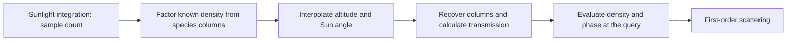

# Accuracy Controls: Current Qualification

This document maps the experimental findings to usable controls and unresolved
qualification work. The [active findings](attribution-results.md) own measured
values, reference allowances and evidence identities. The
[error inventory](error-sources.md) owns the next attribution decisions, and
the [status](status.md) owns execution and formal-review state.

Correctness means agreement with the declared equations, applicable physical
properties and independently checked numerical references. Observation scores
are separate. These controls include generation-time and runtime operations;
they are not limited to cache resolution or stored values.

| Control                                                | Scientific mechanism                                                                                                      | Current qualification                                                                                                                                                                                                                                                                                                                                                                                                                                                                                                                                                                                                                                                                                                                              | Cost and scope                                                                                                                                               |
| ------------------------------------------------------ | ------------------------------------------------------------------------------------------------------------------------- | -------------------------------------------------------------------------------------------------------------------------------------------------------------------------------------------------------------------------------------------------------------------------------------------------------------------------------------------------------------------------------------------------------------------------------------------------------------------------------------------------------------------------------------------------------------------------------------------------------------------------------------------------------------------------------------------------------------------------------------------------- | ------------------------------------------------------------------------------------------------------------------------------------------------------------ |
| Sunlight integration count                             | Reduce quadrature error in optical depth; predict the response from the integrand's endpoint derivatives.                 | Held source-column refinement and the corrected original-grid S160-to-S320 prediction pass. The held count removes about 75% of the component error and the response forecast is accurate to 0.165-0.183%. Wider geometry and recurrence remain unqualified.                                                                                                                                                                                                                                                                                                                                                                                                                                                                                       | More generation/reference integration work; it does not inherently enlarge a fixed-size cache. GPU arithmetic parity is separate.                            |
| Transport integration count                            | Reduce error integrating the recurrence along a ray.                                                                      | Component source/transport compensation is demonstrated; finer transport improves selected P2 values. A complete later-order propagation model is not qualified.                                                                                                                                                                                                                                                                                                                                                                                                                                                                                                                                                                                   | More integration work at the stage where the control is applied.                                                                                             |
| Altitude placement/count                               | Reduce interpolation error by shortening or relocating intervals.                                                         | Selected first- and second-order components improve, but the finer-count prediction exposes competing effects and range limits. A universal count law fails.                                                                                                                                                                                                                                                                                                                                                                                                                                                                                                                                                                                       | Enlarges stored fields and changes generation/transport work; distribution matters as well as count.                                                         |
| Density-factored first-order fields                    | Apply known local density analytically rather than interpolating its exponential variation inside a combined field.       | Strong independent component improvements; residual phase and transmission errors are now separated. This alone is not a complete first-order correction.                                                                                                                                                                                                                                                                                                                                                                                                                                                                                                                                                                                          | Changes representation and query arithmetic; a production storage/performance tradeoff has not been measured.                                                |
| Density-factored geometric sunlight columns            | Reconstruct the smoother part of each species column, then form optical depth and transmission.                           | Exact-solar and original-solar-grid controls pass. The finite-top-adjusted form also reproduces the exact finite-top vertical manufactured field. Tested first-order samples only.                                                                                                                                                                                                                                                                                                                                                                                                                                                                                                                                                                 | Geometric columns can be shared across wavelengths; extra query arithmetic and GPU layout require separate measurement.                                      |
| Analytic first-order phase evaluation                  | Evaluate the declared phase function at the actual angle instead of reconstructing its directional shape from samples.    | Removes an identified outgoing interpolation contribution. That contribution has opposite signs at the two tested geometries, so removing it alone can worsen combined error.                                                                                                                                                                                                                                                                                                                                                                                                                                                                                                                                                                      | Exchanges directional reconstruction work for analytic evaluation. This factorization does not automatically apply to arbitrary higher-order angular fields. |
| Incoming radial count/distribution                     | Resolve polar structure and physical interval boundaries in the scattering integral.                                      | Independent component tests establish substantial effects. The observed factorial response is now split into a constant-background normalization term and a larger directional-field term. The smooth partition locates most of the directional response toward the Sun, with compensation elsewhere. Absolute angular error and a general response law remain unqualified.                                                                                                                                                                                                                                                                                                                                                                        | More incoming-ray evaluations; a geometry-aware allocation differs from merely increasing a full-sphere count.                                               |
| Incoming azimuth count                                 | Resolve variation around the local radial axis.                                                                           | Separate angular controls establish a different response from radial refinement. Equal total direction counts can have different error.                                                                                                                                                                                                                                                                                                                                                                                                                                                                                                                                                                                                            | More incoming-ray evaluations; count aspect ratio is an operational control.                                                                                 |
| Incoming sampling frame                                | Align coordinates with known directional structure at fixed sample count.                                                 | The independently checked phase-product benchmark passes both geometries: Sun-aligned sampling reduces error by over 99.98% against the matched radial rule. The boundary-aware atmospheric test overshoots at the coarse count; its combined accuracy tests remain unresolved under the registered reference criterion. The matched analytic control identifies polar placement as sufficient to cause the large loss on the smooth phase field. The endpoint control identifies lost azimuth cancellation and predicts a new analytic count. The polar-angle correction passes one atmospheric channel at matched count; the second channel remains unresolved. This repairs the experimental Sun-aligned rule, not a qualified production gain. | Same direction count in the manufactured comparison; frame transforms and treatment of physical boundaries need qualification.                               |
| Scattering-order limit                                 | Reduce the missing nonnegative physical tail.                                                                             | Physical sign is known; the magnitude/altitude-interaction forecast fails part of its held domain. More orders cannot erase an already excessive physical P1+P2 contribution.                                                                                                                                                                                                                                                                                                                                                                                                                                                                                                                                                                      | Adds recurrence passes and transient work; retained layout depends on implementation.                                                                        |
| Storage precision and accumulation                     | Reduce rounding or representation error at the relevant arithmetic boundary.                                              | Storage contrasts on the selected source/reconstruction samples are small or unresolved under allowances. They do not establish full GPU arithmetic behavior.                                                                                                                                                                                                                                                                                                                                                                                                                                                                                                                                                                                      | More bits affect bandwidth/storage; different accumulation affects computation. No universal benefit is demonstrated here.                                   |
| Reference error allocation and integration coordinates | Allocate tolerance to physical contributions and resolve nearly tangent geometry without changing the requested accuracy. | Distinct reference failures are resolved under unchanged tolerance criteria. These are verified operational controls of the reference runner.                                                                                                                                                                                                                                                                                                                                                                                                                                                                                                                                                                                                      | Redistributes work; this does not itself diagnose the same defect in the production cache.                                                                   |

The exact-ground reflected-light limit is a correctness repair, rather than an
accuracy setting to tune freely. Its missing contribution is now measured and
can compensate a larger positive numerical error. A valid implementation must
respect the declared boundary even when another error makes a coarse result
look better.

The most complete explanation currently concerns first-order reconstruction:
coarse source integration dims the field; raw density reconstruction introduces
a larger positive error; outgoing phase interpolation can add either sign;
altitude interpolation of transmission adds another negative error. Correcting
the identified representations restores the expected source-count behavior
on the original grid. These are structured errors, not random noise.

The tested first-order combination follows this sequence; higher-order
transport remains a separate qualification:

The broader objective remains open. The held source-count prediction now passes.
The next substantial qualification should extend corrected cached first-order
reconstruction to complete viewing rays at fixed other settings. The recurrence
already evaluates direct first-order scattering at its own query points;
changing only final-view J1 reconstruction leaves those fields unchanged. The
completed angular partition uses saved nodes to locate the remaining response
near the horizon. It does not establish absolute angular error or automatically
justify another count ladder. Execution is paused at the owner's request. Local representation success cannot
stand in for those missing parts. Formal standards verification remains
deferred under the owner's scheduling direction.
